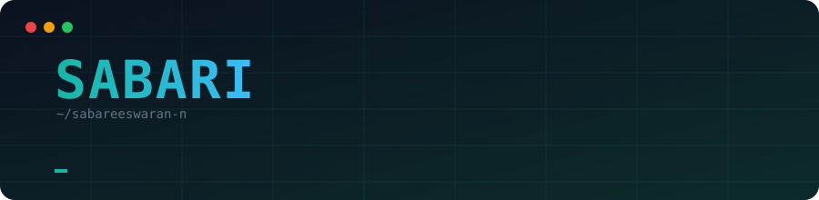

<div align="center">



*Building reliable AI-powered products. Learning security by building it.*

[](https://www.linkedin.com/in/sabareeswaran-n-346902267)
[](https://creativedudes.tech)
[](mailto:sabareeswaran.n26@gmail.com)

</div>

### `sabari@github:~$ ./metrics.sh`


### `sabari@github:~$ whoami`
```python
sabari = {
    "role":       "Software Engineer, AI Voice & Platforms @ AloftLabs AI",
    "experience": "3+ years in production (healthcare, workforce, enterprise)",
    "location":   "Pollachi, Tamil Nadu, India",
    "building":   "AegisForge: evidence-first, LLM-assisted security lab tool",
    "learning":   "Application security (Burp Suite, OWASP), LLM evaluation",
    "motto":      "No evidence, no finding.",
}
```

### `sabari@github:~$ cat principles.txt`
```text
[+] Build things that talk to the real world, not just demos
[+] Put guardrails around anything an AI model is allowed to do
[+] Validate changes against reality before shipping them
[+] Design for failure: fallbacks, retries, graceful handoffs
[+] Keep one codebase serving many users without them seeing each other
[+] Prefer configuration over redeploys
```

### `sabari@github:~$ cat skills.json`
```jsonc
{
  "ai_voice":  ["GPT-4o", "Groq LLaMA", "Deepgram STT", "ElevenLabs TTS", "Twilio streams"],
  "backend":   ["Python", "Django REST", "PHP", "Java", "REST APIs", "cron jobs"],
  "frontend":  ["React", "Tailwind", "JavaScript"],
  "data":      ["MySQL", "Redis"],
  "cloud":     ["AWS EC2 / RDS / S3 / Secrets Manager", "Docker", "Nginx", "GitLab CI/CD", "Jenkins"],
  "security":  ["Burp Suite", "OWASP-style lab testing"]
}
```


### `sabari@github:~$ tail -f current_project.log`
```text
AegisForge v0.1  [ IN PROGRESS ]
 |- scan lab target (Nmap, intentionally vulnerable app)
 |- local LLM proposes weaknesses as structured JSON
 |- fixed library of SAFE tests proves or disproves each one
 |- every finding links to saved evidence, then a report is generated
 `- benchmark: false-positive rate, valid-output rate, speed (2-3 local models)

rules: lab targets only | LLM picks from approved tests, never writes exploits | no destructive tests
```

### `sabari@github:~$ git log --career`
```text
* 2025-05 -> now   Software Engineer        AloftLabs AI Technologies
|                  AI automation, multi-tenant web platforms
* 2024-06 -> 2025-05  Software Engineer Intern   AloftLabs AI Technologies
                   Desktop and backend tooling, shipped end to end
```

### `sabari@github:~$ cat education.txt`
```text
MCA  (Distance)   Bharathiar University                        2026 - 2028   [in progress]
BCA               Nallamuthu Gounder Mahalingam College        2022 - 2025   79%
```

### `sabari@github:~$ ./contributions`


<div align="center">

*Ship carefully. Validate with evidence. Build things that hold up in production.*

</div>
